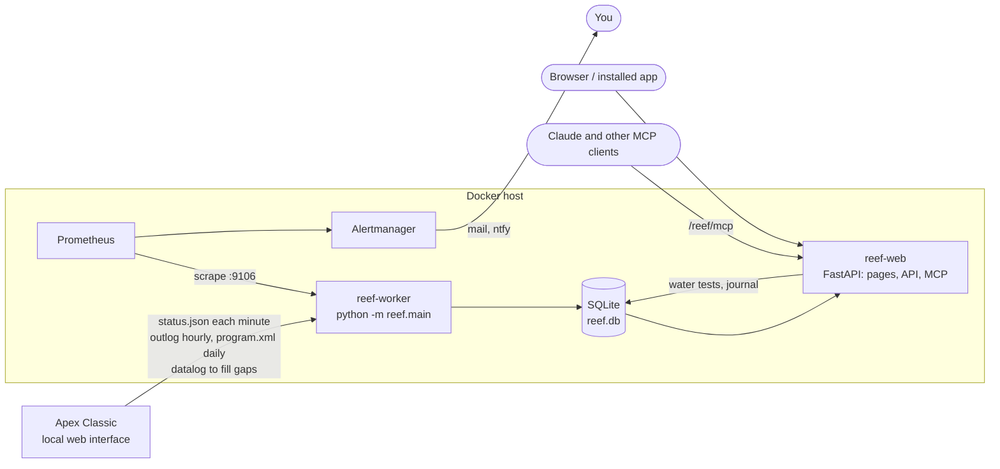

# Architecture

One image, two services:

- **reef-worker** is the only client of the Apex. It polls, stores the history, judges the alert conditions,
  analyses the history hourly, writes the weekly report, copies the database nightly, and publishes everything for
  Prometheus. It holds the Apex's sign-in.
- **reef-web** serves the pages (React and Mantine, built into the image), the JSON API under `/reef/api`, and the MCP
  endpoint. It reads the worker's database and writes only what people record (water tests, journal entries). It
  never sees the Apex's password.

Alert delivery is left to Prometheus and Alertmanager, which already do grouping, silences, repeats and receivers
well, so the worker exposes judgements rather than sending mail itself.

## The worker

`worker/reef/`

| Module | Does |
|---|---|
| `main.py` | the loop: poll, record, judge, publish; hourly the outlet log, the analysis and the weather; daily the programs and the backup; weekly the report; at night the log backfill |
| `apex.py` | the one Apex client: a request at a time, a breaker that backs off on slow or failed answers, and the parsers for status.json, datalog.json, outlog.json and program.xml |
| `site.py` | the site file: sensors, modules, conditions, notices, reactor; the module checks are derived from the module list |
| `conditions.py` | the condition engine: pending times, clearing bands, rates over a window, critical hiding warning, state kept across restarts |
| `store.py` | the SQLite schema and writes |
| `analysis.py` | expected values, findings and forecasts ([analysis.md](analysis.md)) |
| `reactor.py` | the calcium reactor's CO2 per day and the drip warning |
| `report.py` | the weekly report |
| `water.py` | water-test parameters, units, conversions and plausibility |
| `programs.py` | program versions and their differences |
| `weather.py` | the outdoor temperature from Open-Meteo |
| `metrics.py` | the Prometheus metrics |

Design choices worth knowing:

- **The worker's clock is the time axis.** Each poll is stored at the time it was received. The Apex's own clock is
  kept as a diagnostic, and a step in it is an event, not a jump in the history.
- **Gentle with the unit:** one request at a time with a priority order, a breaker, and the slow log only at night
  ([apex-classic.md](apex-classic.md#being-gentle)).
- **Polls win.** A value from the unit's own log is stored only where no poll covers its 10-minute step.
- **Mode and energized are separate.** An outlet's mode (auto or manual) and whether it is on are stored apart, so a
  program cycle is never taken for an override.
- **Old values never pass for the present.** Metrics for readings disappear when the latest poll is stale; the pages
  say how old the last poll is.
- **No false all-clear.** Conditions keep their last state while the Apex does not answer, and the alert rules keep
  them firing while the worker is down.

## The database

One SQLite file in WAL mode: the worker writes, reef-web reads (and writes its two tables).

| Table | Holds |
|---|---|
| `sensors`, `outlets` | identities: the unit's serial, the `did`, the name and type, first and last seen |
| `readings` | probe values (sensor, time, value), one a minute, plus the unit's log where polls are missing |
| `switch_states`, `outlet_states` | changes only: a switch's state; an output's mode, energized, health and intensity |
| `outlet_log`, `outlog_days` | the unit's own outlet log, and which days were read |
| `datalog_days` | which days of the unit's probe log were asked for, and with what result |
| `conditions_active` | the conditions active now, so a restart does not re-alert or forget |
| `events` | alerts started and ended, power failures, clock steps, program changes, findings, notices, new modules |
| `program_versions` | the programs as dated versions, stored only when something changed |
| `water_tests`, `journal` | what people record, with who and from where (app or MCP); deleting marks a row deleted |
| `reports` | the weekly reports |
| `kv` | small state: the latest status, the analysis result, the Apex's timezone history, report and backfill marks |

A year at one sample a minute for about 15 probes is roughly 8 million readings, a few hundred MB. The charts read
the history in time buckets, so long ranges stay quick.

## The web app

`worker/reefweb/` (API and MCP) and `frontend/` (the pages).

- `app.py`: the routes under `/reef`. Every API route needs a signed-in caller, and writes need the CSRF header or a
  bearer token. The built app is served with long caching for hashed assets, and `index.html` for every page route.
- `auth.py`: the three sign-in modes ([configuration.md](configuration.md#sign-in)).
- `mcp_server.py`: the MCP tools ([mcp.md](mcp.md)), on the official MCP Python SDK, stateless Streamable HTTP, with
  a DNS-rebinding guard on the host name.
- `overview.py`, `queries.py`, `reactor.py`: what the pages and tools show.
- The pages are React 19 with Mantine 9 and TanStack Query. The pages: Now, Charts, Tests, Analysis, Reactor,
  Journal, Events, Programs and Reports. A service worker caches the app's own files, never the API, so it installs
  as an app and opens without a network but never shows an old reading as current.

## Security model

- **The Apex's password is only in the worker.** It comes from `.env` or a secret file and is never logged; its
  `repr` hides it.
- **reef-web can only record.** It has no path to the Apex, and nothing in the API or MCP changes an outlet or a
  program.
- **Every API and MCP request is signed in.** In basic mode the page itself asks too, so the browser signs in before
  any data loads; in forward mode the proxy in front checks every request.
- **Writes from a browser need a custom header**, which cross-site forms cannot send. That covers cookies and Basic
  credentials, which browsers attach on their own.
- **The MCP endpoint answers only to its own host name**, against DNS rebinding.
- **Prometheus and Alertmanager have no sign-in.** Their ports are bound to the host only.
- **Outlet control, when it comes, will be off by default.** Its design is in place: requests that a person approves,
  every override with a deadline that survives restarts, the safety lines an override suppresses enforced by the
  console meanwhile, and interlocks checked on the resulting state.
